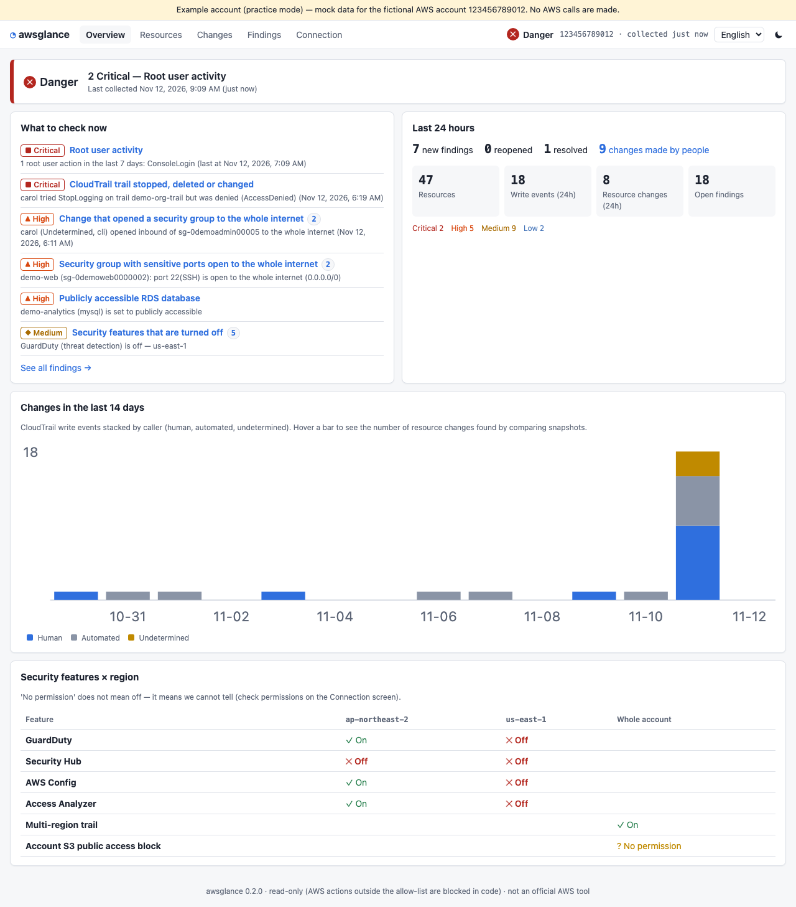
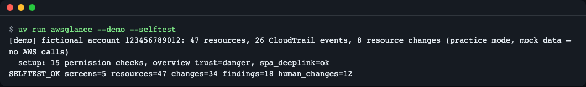
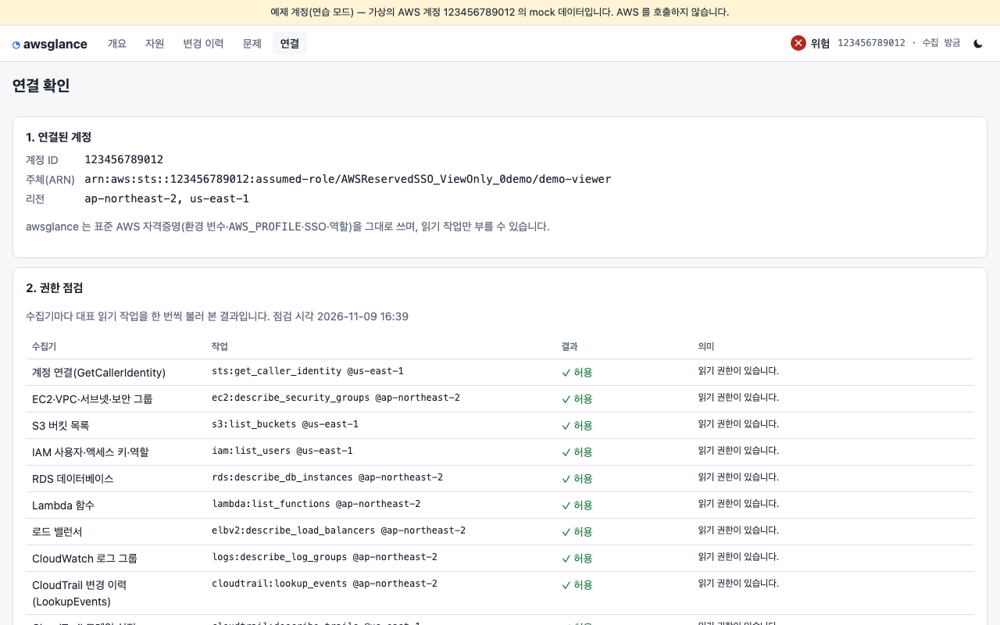
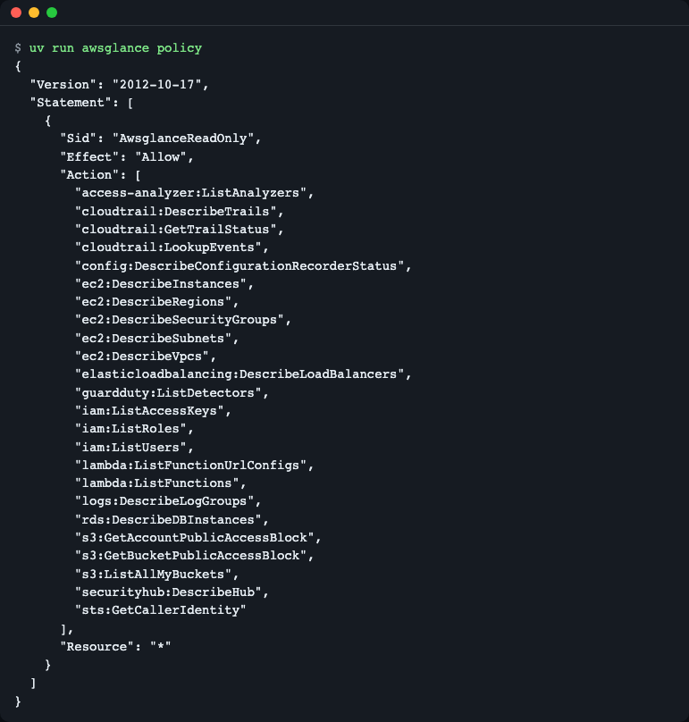
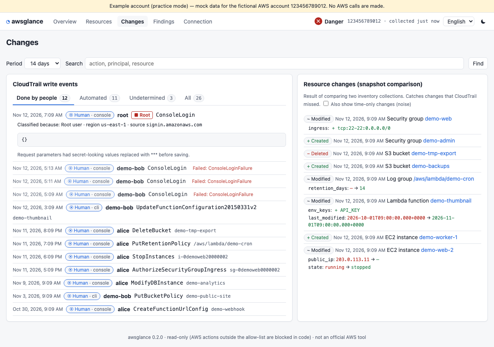
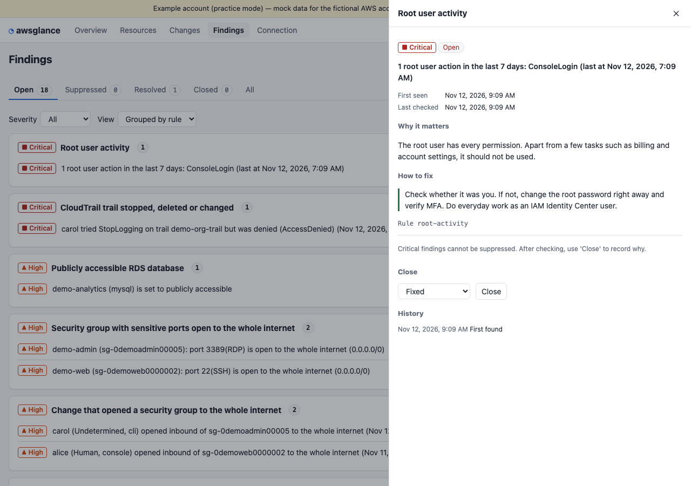
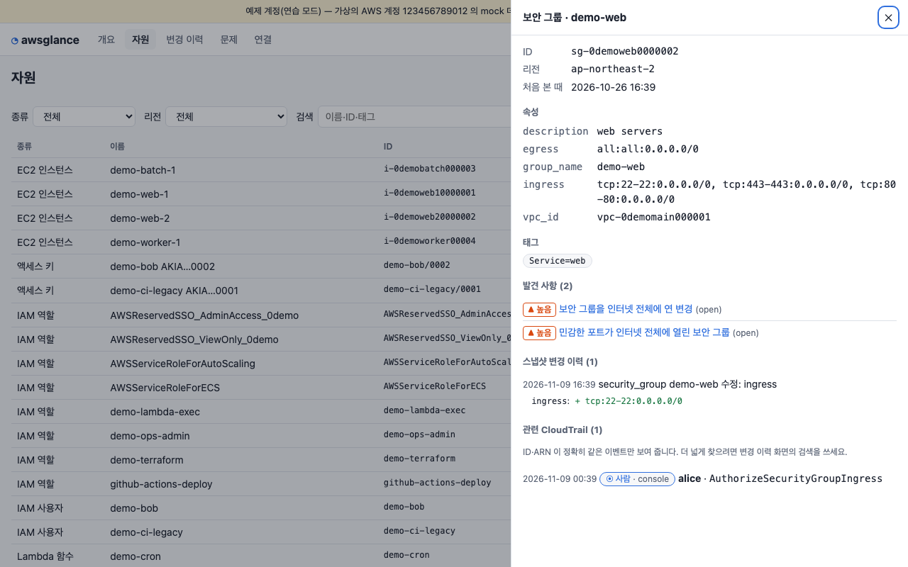
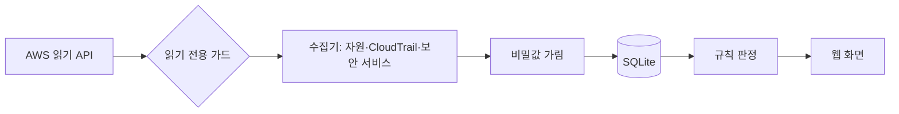

# awsglance

[English](README.md) | **한국어**

AWS 계정 하나의 "누가 무엇을 바꿨나 · 위험한 설정 · 지금 확인할 것"을 한 화면에 모아 보여 주는 읽기 전용 웹 상황판입니다. 콘솔 여러 화면(Event history, EC2, S3, IAM, 보안 서비스)을 오가며 손으로 확인하던 아침 점검을 줄여 줍니다. 코드로 강제한 읽기 전용이라 무엇도 바꾸지 못합니다.


*연습 모드의 개요 화면: 신뢰 신호, 지금 확인할 것, 최근 24시간 요약이 한 장에 보입니다(아래로 내리면 14일 변경 그래프가 이어집니다).*

## 이런 분께
- AWS 계정 1개를 혼자, 또는 소규모로 운영하고 전담 보안·SRE 가 없는 경우
- 장애나 이상 징후가 있을 때 "최근에 누가 뭘 바꿨지?"를 바로 알고 싶은 경우
- 계정을 새로 넘겨받아 어디가 열려 있는지 먼저 훑어보고 싶은 경우

## 설치
Python 3.12 이상이 필요하고, 실행 도구는 [uv](https://docs.astral.sh/uv/)를 씁니다. 별도 Node 설치는 필요 없습니다(화면은 빌드된 상태로 패키지에 들어 있습니다).

```bash
curl -LsSf https://astral.sh/uv/install.sh | sh      # uv 설치(이미 있으면 생략)
uvx awsglance --demo                                  # 설치 없이 바로 실행
# 또는 소스에서
git clone https://github.com/LeeGyeongPil/awsglance && cd awsglance
uv run awsglance --demo
```
최소 리눅스 환경(컨테이너)에서는 `curl` 과 `ca-certificates` 가 있으면 됩니다.

## 빠르게 시작하기 — 자격증명 없이 연습 모드
```bash
uv run awsglance --demo --no-browser --port 8742
```
```
[demo] fictional account 123456789012: 47 resources, 26 CloudTrail events, 8 resource changes (practice mode, mock data — no AWS calls)
awsglance 0.1.3 — open http://127.0.0.1:8742/  (Ctrl+C to stop)
```
브라우저에서 출력된 주소를 열면 맨 위에 보인 개요 화면이 나타납니다. `--no-browser` 를 빼면 브라우저가 자동으로 열립니다.

**연습용 목(mock) 모드입니다.** 가상의 예제 계정(`123456789012`)의 JSON 을 읽어 실제 수집·판정 코드 경로를 그대로 통과시키지만 AWS 를 호출하지는 않습니다. 실제 모드와의 차이는 두 가지입니다: 데이터가 가짜라는 것, 그리고 실제 모드는 계정 규모·리전 수에 따라 첫 수집에 수 분이 걸릴 수 있다는 것(CloudTrail 조회 속도 제한 때문)입니다.

브라우저 없이 모든 화면 API 를 자동 점검하려면 자체 점검을 씁니다(임시 포트에 서버를 잠깐 띄웠다가 끝냅니다).
```bash
uv run awsglance --demo --selftest
```

*`SELFTEST_OK` 는 5개 화면과 API 가 모두 응답했다는 뜻이고, 종료 코드는 0 입니다.*

## 내 계정 연결하기
awsglance 는 API 키를 따로 받지 않고 표준 AWS 자격증명 체인(환경 변수·프로필·SSO·역할)을 그대로 씁니다.

```bash
uvx awsglance --profile myprof                 # SSO 등으로 로그인한 프로필
uvx awsglance --profile myprof --regions ap-northeast-2,us-east-1
```
1. 프로필에 붙일 **최소 IAM 정책**을 출력합니다: `uv run awsglance policy` (레포의 `iam-policy.json` 과 같은 내용, 테스트로 일치 검사).
2. 서버를 띄우고 `/setup` 연결 화면에서 **권한 점검 표**를 봅니다. 수집기마다 허용·거부·사용 불가가 따로 보입니다.


*권한 점검 표. 권한이 없어 못 본 것은 "꺼짐"이 아니라 "권한 없음"으로 따로 표시됩니다(모르는 것을 꺼졌다고 단정하지 않습니다).*


*허용하는 작업은 24개의 목록·조회 API 뿐입니다(`secretsmanager:GetSecretValue`·`s3:GetObject` 같은 값을 읽는 작업은 없습니다).*

## 화면 둘러보기
| 화면 | 주소 | 답해 주는 질문 |
|---|---|---|
| 개요 | `/` | 오늘 계정이 괜찮은가? 지금 확인할 것은? |
| 변경 이력 | `/changes` | 누가 무엇을 바꿨나? ("사람이 한 작업" 탭) |
| 문제 | `/findings` | 위험한 설정·이벤트가 무엇이고 어떻게 고치나? |
| 자원 | `/resources` | 이 자원의 속성·변경 이력·관련 이벤트는? |
| 연결 | `/setup` | 어떤 주체로 붙었고 어떤 권한이 부족한가? |

### 누가 바꿨지?

*"사람이 한 작업" 탭. 서비스 자동 호출은 걸러지고 사람의 변경만 남습니다.*

### 위험한 설정과 대응

*발견 사항 상세. 규칙 설명과 대응 방법, 처리 기록이 함께 나옵니다. 숨김은 사유가 필수이고 기한이 있습니다.*

### 자원 중심으로 보기

*보안 그룹 하나의 속성, 변경 이력, 관련 CloudTrail 이벤트, 발견 사항을 한곳에서 봅니다.*

관련 CloudTrail 이벤트는 자원 ID·ARN 이 정확히 같은 것만 보여 줍니다. 이름이 비슷한 자원(`demo-web` / `demo-webhook`)의 이벤트가 섞이지 않게 일부러 덜 보이며, IAM 액세스 키는 연결하지 않습니다. 더 넓게 찾을 때는 변경 이력 화면의 검색을 쓰세요.

## 사용법
| 명령·옵션 | 하는 일 | 예 |
|---|---|---|
| `awsglance` | 상황판 서버를 띄우고 브라우저를 엽니다 | `awsglance --profile myprof` |
| `--demo` | 가상 예제 계정으로 연습(자격증명·AWS 호출 없음) | `awsglance --demo` |
| `--selftest` | 서버를 잠깐 띄워 모든 화면 API 를 점검하고 종료(`--demo` 와 함께) | `awsglance --demo --selftest` |
| `policy` | 최소 IAM 정책 JSON 출력 | `awsglance policy` |
| `export` | 서버 없이 `file://` 로 열리는 읽기 전용 정적 사본 생성 | `awsglance export --demo --out ./site` |
| `--out` | `export` 결과 폴더(기본 `./awsglance-export`) | `--out ./site` |
| `--profile` | AWS 프로필(기본 `AWS_PROFILE`) | `--profile myprof` |
| `--regions` | 리전을 쉼표로 지정(기본: 활성 리전 전부) | `--regions ap-northeast-2` |
| `--host` / `--port` | 바인드 주소·포트(기본 `127.0.0.1`, 포트 1~65535) | `--port 8742` |
| `--allow-host` | 추가로 허용할 Host 헤더(반복 가능) | `--allow-host ops.example.com` |
| `--data-dir` | SQLite DB 위치(기본 `~/.local/share/awsglance`) | `--data-dir ./data` |
| `--no-browser` | 브라우저를 열지 않음 | |
| `--version` | 버전 출력 | |

### 자주 쓰는 시나리오
- **아침 점검**: 개요를 엽니다 → 신뢰 신호와 "지금 확인할 것" 목록이 보입니다 → 위험(critical)이 있으면 해당 줄을 눌러 문제 화면으로 갑니다.
- **장애 직후**: 변경 이력의 "사람이 한 작업" 탭을 봅니다 → 최근 변경이 시간순으로 나옵니다 → 이벤트를 펼쳐 요청 내용(비밀값은 가려짐)을 봅니다.
- **다른 기기에서 열기**: 로컬이 아닌 주소로 띄우면 접근 토큰이 필수이고, 허용할 Host 도 직접 알려야 합니다.
  1. `AWSGLANCE_TOKEN=<긴 임의 문자열> uv run awsglance --host 0.0.0.0 --allow-host <이 기기의 IP 또는 이름>`
  2. 터미널에 찍힌 주소의 `127.0.0.1` 을 그 IP 로 바꾸고 `?token=…` 을 붙여 다른 기기의 브라우저에서 엽니다.
  3. `--allow-host` 가 없으면 Host 헤더 검사(DNS 리바인딩 방지) 때문에 400 이 납니다. 오류 문구에 필요한 옵션이 적혀 있습니다.

### 서버 없이 공유하기 (export)
`uv run awsglance export --demo --out ./site` 로 한 파일짜리 `site/index.html` 을 만들고 브라우저로 열면 됩니다(화면은 `index.html#/changes?tab=human` 처럼 `#` 뒤 경로로 고름). 사본은 만든 시점의 읽기 전용 스냅샷이라 숨김·닫기는 막힙니다. 값은 가려진 상태지만 계정 구조가 담기므로 신뢰할 수 있는 곳에만 전달하세요.

## 설정
API 키는 필요 없습니다. 선택 항목은 [.env.example](.env.example)에 있습니다(`AWS_PROFILE`, `AWS_REGION`, `AWSGLANCE_DATA_DIR`, `AWSGLANCE_TOKEN`).

데이터 폴더의 `config.toml` 로 수집 주기와 사람/자동 분류를 바꿀 수 있습니다. 파일이 없으면 기본값을 씁니다.
```toml
[collect]
regions = ["us-east-1", "ap-northeast-2"]   # 비우면 활성 리전 자동 탐지
inventory_minutes = 30
cloudtrail_minutes = 5
retention_days = 180
max_trail_pages = 20

[classify]
human_roles = ["Admin*"]          # 이 역할로 들어온 호출은 '사람'
automated_roles = ["platform-*"]  # 이 역할로 들어온 호출은 '자동'
```

## 무엇을 점검하나 — 규칙 12개
| 규칙 id | 종류 | 심각도 | 보는 것 |
|---|---|---|---|
| `root-activity` | 이벤트 | critical | 루트 사용자 활동 |
| `trail-tampering` | 이벤트 | critical | CloudTrail 중지·삭제·변경(시도했다가 거부된 것 포함) |
| `sg-opened-world-event` | 이벤트 | high | 보안 그룹을 인터넷 전체에 연 변경 |
| `console-login-failed` | 이벤트 | medium | 콘솔 로그인 실패 |
| `sg-open-world` | 설정 | high | 민감한 포트(SSH·RDP·DB)가 인터넷 전체에 열린 보안 그룹 |
| `rds-public` | 설정 | high | 공개 접근 가능한 RDS 데이터베이스 |
| `s3-bucket-pab-off` | 설정 | medium | 퍼블릭 액세스 차단이 꺼진 S3 버킷 |
| `lambda-url-no-auth` | 설정 | medium | 인증 없는 Lambda 함수 URL |
| `iam-key-old` | 설정 | medium | 90일 넘게 교체하지 않은 액세스 키 |
| `posture-off` | 태세 | medium | 꺼져 있는 보안 기능(보안 기능 × 리전 행렬) |
| `sg-default-has-rules` | 설정 | low | 기본 보안 그룹에 규칙이 있음 |
| `logs-no-retention` | 설정 | low | 보존 기간 없는 로그 그룹 |

규칙 설명과 대응 방법 전문은 서버를 띄운 뒤 `/api/rules` 에서 볼 수 있습니다. 발견 사항은 열림 → 해결(안 보이면) → 재발(다시 보이면)로 움직이고, 숨김·닫기는 사유가 처리 기록에 남습니다.

## 동작 원리

1. 모든 AWS 호출은 **가드**를 지납니다. `allowlist.json` 의 24개 작업이 아니면 요청이 만들어지기 전에 막습니다.
2. 수집기가 자원 목록(30분마다), CloudTrail(5분마다, 겹쳐 받고 `EventId` 로 중복 제거), 보안 서비스 상태를 모읍니다.
3. 저장 전에 **비밀값을 가립니다**. 읽기 API 도 비밀을 돌려줄 수 있기 때문입니다(예: Lambda 환경 변수 값, 요청 파라미터의 키 문자열).
4. 이전 스냅샷과 비교해 CloudTrail 이 놓친 변경도 '자원 변경'으로 남깁니다. 권한이 없어 못 본 범위는 '삭제'로 판정하지 않습니다.
5. 규칙이 열린 문제를 만들고, 호출 주체를 `userIdentity` 로 사람/자동으로 가릅니다(SSO 역할 `AWSReservedSSO_*`·콘솔 세션은 사람, 서비스 연결 역할·`invokedBy` 는 자동). 분류를 바꾸려면 [설정](#설정)의 `[classify]` 를 보세요.

### 읽기 전용을 두 겹으로 지키는 이유
- **서버 쪽**: `awsglance policy` 의 IAM 정책이 24개 작업만 허용합니다.
- **클라이언트 쪽**: 정책을 넓게 붙여도 코드가 허용 목록 밖을 막습니다(`src/awsglance/aws/guard.py`).
- `Get*`·`Describe*` 같은 **접두사 허용은 위험**합니다. `secretsmanager:GetSecretValue`, `ssm:GetParameter`, `s3:GetObject`, `ec2:GetPasswordData`, `lambda:GetFunction`(코드 URL) 모두 이름은 읽기지만 비밀을 돌려줍니다. 그래서 작업을 하나씩 명시한 목록만 쓰고, 테스트가 botocore 모델의 쓰기·비밀 작업 500개 이상이 전부 막히는지 확인합니다.
- 훅은 `before-call` 이 아니라 가장 이른 이벤트인 `provide-client-params` 에 겁니다. 테스트용 Stubber 가 `before-call` 에서 먼저 응답해 거짓으로 통과하는 함정을 피하기 위해서입니다.

기본은 `127.0.0.1` 에서만 접속됩니다. 다른 주소로 바인드하면 토큰이 필수이고, Host 헤더 허용 목록(DNS 리바인딩 방지)과 상태 변경 요청의 Origin 검사를 합니다.

## 언제 쓰나
- AWS 계정 1개를 소규모로 운영하면서 "최근 누가 무엇을 바꿨나"와 위험한 설정을 로컬 웹 한 화면에서 가볍게 보고 싶을 때 맞습니다.
- 더 넓은 점검 범위나 컴플라이언스 보고가 필요하면 [Prowler](https://github.com/prowler-cloud/prowler)나 [ScoutSuite](https://github.com/nccgroup/ScoutSuite)를, SQL 로 자원을 질의하고 싶으면 [Steampipe](https://github.com/turbot/steampipe)를 살펴보세요.
- 다른 도구의 기능과 사용법은 바뀔 수 있으니 각 링크의 공식 문서를 확인하세요.

## 알려진 한계
- CloudTrail `LookupEvents` 는 최근 90일만 조회되고 초당 2회로 제한됩니다. 그래서 첫 수집은 24시간만 받고 다음 회차에 이어 받습니다.
- AWS Health 는 지원 플랜에 따라 쓸 수 없을 수 있습니다(운영 신호 확장은 다음 마일스톤 예정).
- 실제 계정에서의 동작은 CI 로 검증하지 못합니다. 연결 화면의 권한 점검 표와 수집 이력으로 직접 확인하세요.
- 관련 CloudTrail 은 놓치는 이벤트가 있을 수 있습니다(예: Lambda 요청이 함수 ARN 으로 온 경우, 이름만 저장한 로드 밸런서). 오연결을 피하려는 선택입니다.
- 연습 모드의 예제 계정은 가짜입니다.

## 자주 겪는 문제
| 증상 | 원인 | 해결 |
|---|---|---|
| `read-only guard blocked …` 오류 | 허용 목록 밖의 작업을 부르려 함 | 정상 동작입니다. 필요한 읽기 작업이면 이슈로 알려 주세요 |
| `Port 8743 is in use — pick another with --port …` (종료 코드 2) | 같은 포트를 다른 프로세스가 사용 중 | 안내대로 `--port` 로 다른 포트 지정 |
| 연결 화면에서 일부가 "권한 없음" | IAM 권한 부족 | `awsglance policy` 의 정책을 붙이거나 화면의 복사 버튼 사용. 못 본 항목은 판단 보류로 표시됩니다 |
| 첫 수집이 오래 걸림 | CloudTrail 조회 속도 제한·리전 수 | `--regions` 로 범위를 좁힘 |
| 다른 기기에서 열면 401 | 비로컬 바인드는 토큰이 필요함(`AWSGLANCE_TOKEN` 이 없으면 자동 생성해 주소에 `?token=` 으로 출력) | 터미널에 찍힌 주소를 그대로 쓰거나 `AWSGLANCE_TOKEN` 을 직접 지정 |
| 시작할 때 데이터 폴더를 만들지 못해 오류(PermissionError) | 기본 위치(`~/.local/share/awsglance`)에 쓸 수 없음 | `AWSGLANCE_DATA_DIR` 또는 `--data-dir` 로 쓸 수 있는 폴더 지정(오류 문구를 다듬는 일은 로드맵) |
| 화면이 비어 있음(개발 중) | 프론트 빌드 없음 | 소스에서 실행한다면 `cd web && npm ci && npm run build` |

## 로드맵
- **M2 운영 신호**: AWS Health(지원 플랜이 없으면 사용 불가로 표시), 비용 추정·서비스 한도 사용률, 인증서·Lambda 런타임 만료, 일일 요약, 수집 상태 화면
- **M3 편의**: 웹훅 알림, 필수 태그 규칙, 태그 기반 서비스 묶음, 통합 검색, 용어집
- 쓰기·자동 조치와 다중 계정은 계획하지 않습니다(읽기 전용이 이 도구의 약속입니다).

## 개발·기여
```bash
uv run pytest -q          # 모든 테스트는 오프라인으로 실행됨
cd web && npm ci && npm run build    # 프론트를 고쳤을 때(결과는 src/awsglance/static)
```
버그·제안은 이슈로 남겨 주세요. 보안 문제는 [SECURITY.md](SECURITY.md)를 따라 주세요. 변경 기록은 [CHANGELOG.md](CHANGELOG.md).

## 더 알아보기
- CloudTrail Event history: https://docs.aws.amazon.com/awscloudtrail/latest/userguide/view-cloudtrail-events.html
- boto3 이벤트 시스템: https://boto3.amazonaws.com/v1/documentation/api/latest/guide/events.html
- IAM 최소 권한: https://docs.aws.amazon.com/IAM/latest/UserGuide/best-practices.html#grant-least-privilege
- Prowler: https://github.com/prowler-cloud/prowler · ScoutSuite: https://github.com/nccgroup/ScoutSuite · Steampipe: https://github.com/turbot/steampipe
(2026-11-09 확인)

## 라이선스
MIT. 번들된 예제 계정 데이터는 이 프로젝트가 만든 가상 값입니다.
