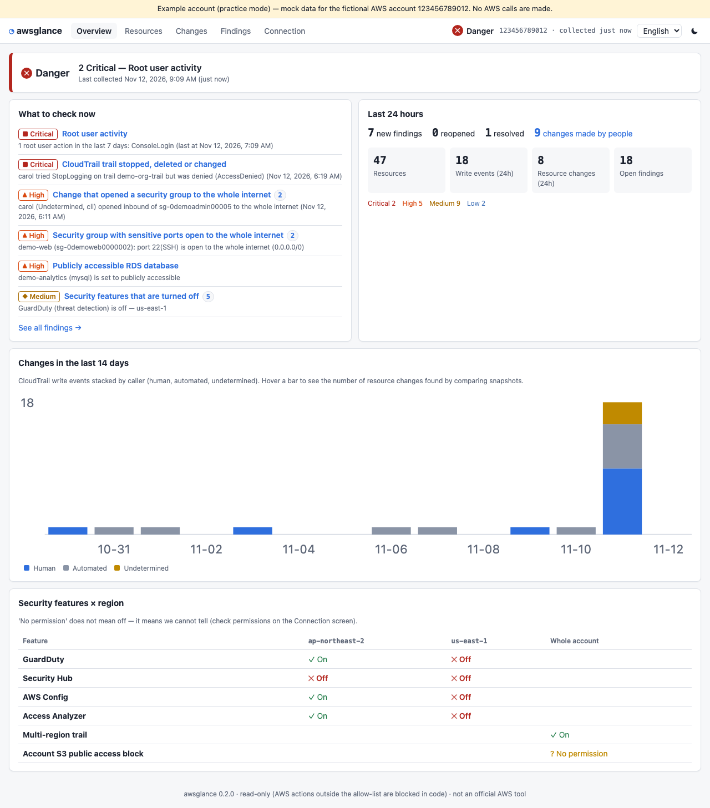
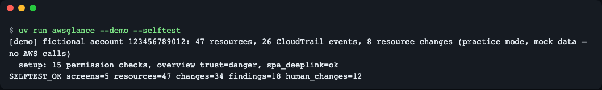
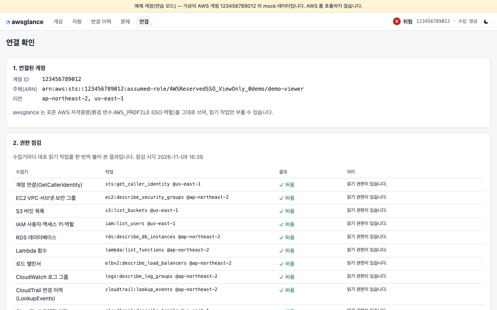
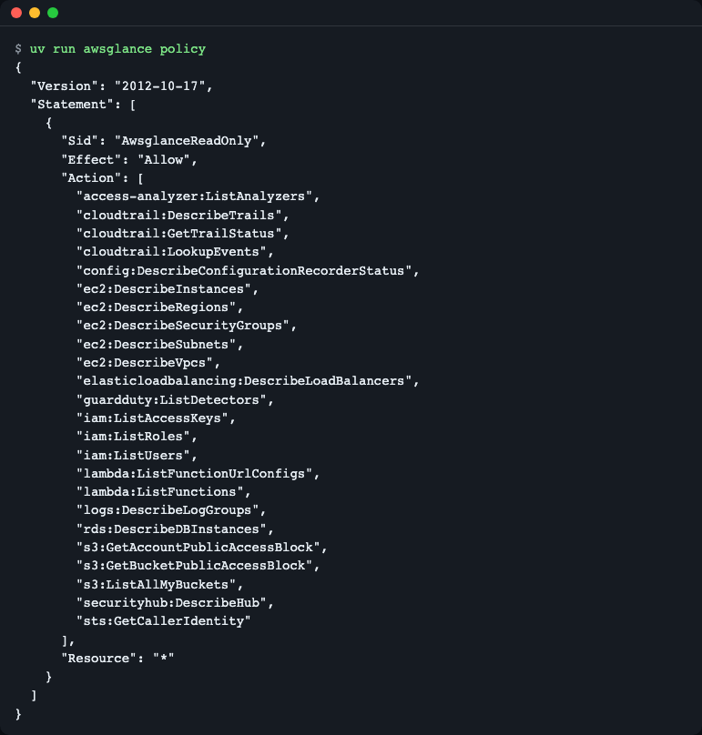
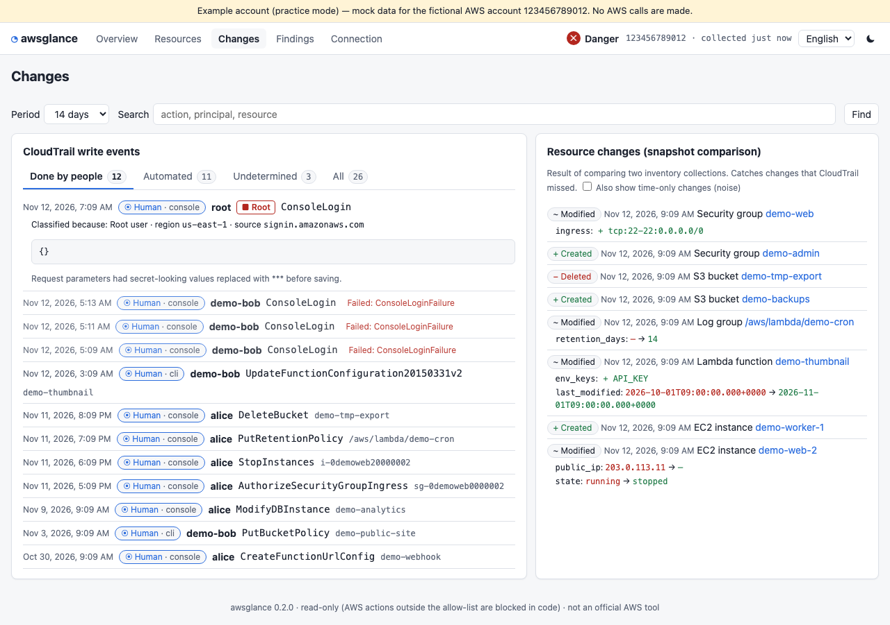
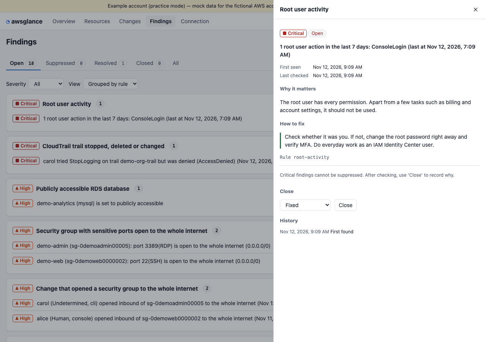
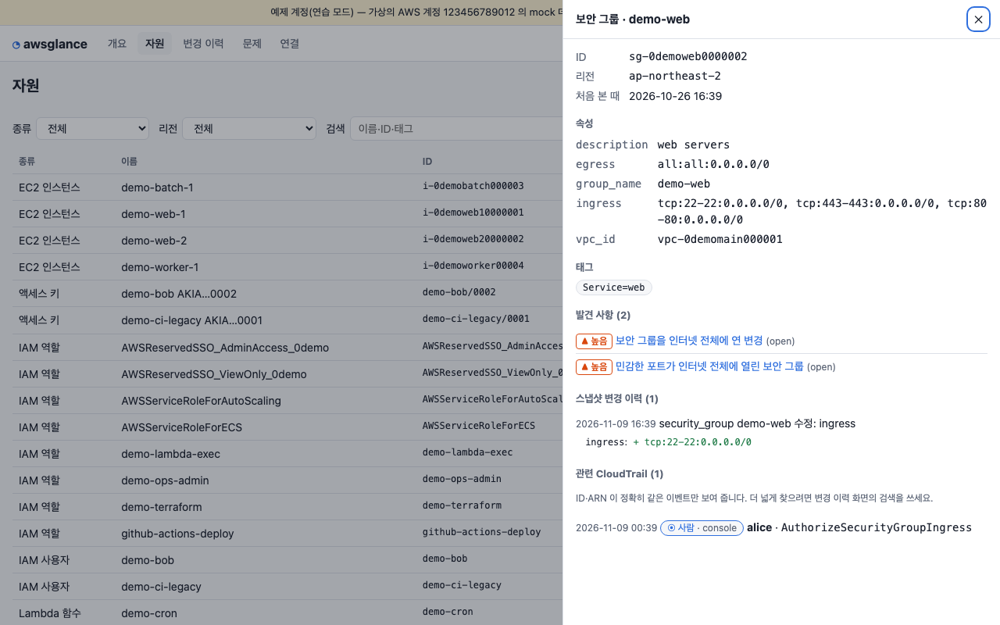
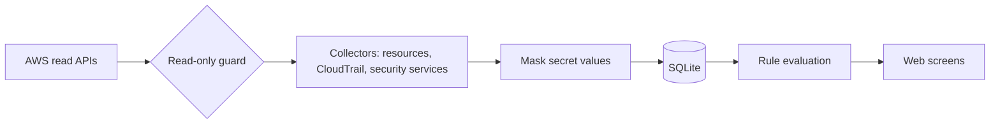

# awsglance

**English** | [한국어](README.ko.md)

awsglance is a read-only, single-process web dashboard for one AWS account: it collects resource lists, CloudTrail events and security-service status, then uses plain rules to show who changed what, risky settings, and what to check now, on one screen. It shortens the morning check of hopping between several console screens (Event history, EC2, S3, IAM, security services), and read-only is enforced in code, so it cannot change anything. Meant for solo developers and small teams without a dedicated security or SRE person. Try it with no AWS credentials (practice mode with a fictional account; mock data, no AWS calls): `uvx awsglance --demo` (no install needed), or from a clone: `uv run awsglance --demo`.


*The overview screen in practice mode: trust signals, what to check now, and the last 24 hours summary fit on one page (scroll down for the 14-day change chart).*

## Who it's for
- You run a single AWS account alone or as a small team, with no dedicated security or SRE person
- When something breaks or looks off, you want to know right away "who changed what recently?"
- You have just taken over an account and want to skim first for what is left open

## Installation
Python 3.12 or later is required, and [uv](https://docs.astral.sh/uv/) is used to run it. No separate Node installation is needed (the UI ships in the package already built).

```bash
curl -LsSf https://astral.sh/uv/install.sh | sh      # Install uv (skip if you already have it)
uvx awsglance --demo                                  # Run right away without installing
# or from source
git clone https://github.com/LeeGyeongPil/awsglance && cd awsglance
uv run awsglance --demo
```
In a minimal Linux environment (container), `curl` and `ca-certificates` are enough.

## Quick start — practice mode without credentials
```bash
uv run awsglance --demo --no-browser --port 8742
```
```
[demo] fictional account 123456789012: 47 resources, 26 CloudTrail events, 8 resource changes (practice mode, mock data — no AWS calls)
awsglance 0.1.2 — open http://127.0.0.1:8742/  (Ctrl+C to stop)
```
Open the printed address in a browser and the overview screen shown at the top appears. Leave out `--no-browser` and the browser opens automatically.

**This is a practice mock mode.** It reads JSON for a fictional example account (`123456789012`) and passes it through the real collection and judging code path, but it does not call AWS. There are two differences from real mode: the data is fake, and real mode can take several minutes for the first collection depending on the account size and number of regions (because of CloudTrail lookup rate limits).

To check every screen API automatically without a browser, use the self-test (it briefly starts a server on a temporary port and then exits).
```bash
uv run awsglance --demo --selftest
```

*`SELFTEST_OK` means all 5 screens and the API responded, and the exit code is 0.*

## Connecting your account
awsglance does not ask for an API key of its own; it uses the standard AWS credential chain (environment variables, profiles, SSO, roles) as is.

```bash
uvx awsglance --profile myprof                 # A profile logged in via SSO, etc.
uvx awsglance --profile myprof --regions ap-northeast-2,us-east-1
```
1. Print the **minimum IAM policy** to attach to the profile: `uv run awsglance policy` (same content as `iam-policy.json` in the repo, checked for equality by a test).
2. Start the server and look at the **permission check table** on the `/setup` connection screen. Allowed, denied and unavailable are shown separately for each collector.


*The permission check table. Things it could not see for lack of permission are shown separately as "no permission", not "off" (it does not assert that something it cannot know is off).*


*The only actions allowed are 24 list and describe APIs (there are no actions that read values, such as `secretsmanager:GetSecretValue` or `s3:GetObject`).*

## Tour of the screens
| Screen | Address | Question it answers |
|---|---|---|
| Overview | `/` | Is the account OK today? What should I check now? |
| Changes | `/changes` | Who changed what? ("Human actions" tab) |
| Findings | `/findings` | What are the risky settings and events, and how do I fix them? |
| Resources | `/resources` | What are this resource's properties, change history and related events? |
| Setup | `/setup` | Which principal is connected, and which permissions are missing? |

### Who changed it?

*The "Human actions" tab. Automatic service calls are filtered out, leaving only changes made by people.*

### Risky settings and how to respond

*Finding detail. The rule description, how to respond, and the handling history appear together. Hiding requires a reason and has an expiry.*

### Viewing by resource

*One security group's properties, change history, related CloudTrail events and findings, all in one place.*

Related CloudTrail events are shown only when the resource ID or ARN matches exactly. Events of similarly named resources (`demo-web` / `demo-webhook`) are deliberately not mixed in, so fewer are shown, and IAM access keys are not linked. For a wider search, use the search on the Changes screen.

## Usage
| Command / option | What it does | Example |
|---|---|---|
| `awsglance` | Starts the dashboard server and opens the browser | `awsglance --profile myprof` |
| `--demo` | Practice with a fictional example account (no credentials, no AWS calls) | `awsglance --demo` |
| `--selftest` | Briefly starts the server, checks every screen API, and exits (use with `--demo`) | `awsglance --demo --selftest` |
| `policy` | Prints the minimum IAM policy JSON | `awsglance policy` |
| `export` | Creates a read-only static copy that opens via `file://` with no server | `awsglance export --demo --out ./site` |
| `--out` | Output folder for `export` (default `./awsglance-export`) | `--out ./site` |
| `--profile` | AWS profile (default `AWS_PROFILE`) | `--profile myprof` |
| `--regions` | Comma-separated regions (default: all enabled regions) | `--regions ap-northeast-2` |
| `--host` / `--port` | Bind address and port (default `127.0.0.1`, port 1 to 65535) | `--port 8742` |
| `--allow-host` | Additional Host header to allow (repeatable) | `--allow-host ops.example.com` |
| `--data-dir` | SQLite DB location (default `~/.local/share/awsglance`) | `--data-dir ./data` |
| `--no-browser` | Do not open the browser | |
| `--version` | Print the version | |

### Common scenarios
- **Morning check**: open the overview → trust signals and the "what to check now" list appear → if there is a critical item, click its row to go to the findings screen.
- **Right after an incident**: look at the "Human actions" tab in Changes → recent changes appear in time order → expand an event to see the request contents (secret values are masked).
- **Opening from another device**: if you start it on a non-local address, an access token is mandatory, and you must also tell it which Host to allow.
  1. `AWSGLANCE_TOKEN=<long random string> uv run awsglance --host 0.0.0.0 --allow-host <this machine's IP or name>`
  2. In the address printed in the terminal, replace `127.0.0.1` with that IP, append `?token=…`, and open it in the other device's browser.
  3. Without `--allow-host` you get a 400 because of the Host header check (DNS rebinding protection). The error message names the option you need.

### Sharing without a server (export)
`uv run awsglance export --demo --out ./site` creates a single-file `site/index.html` that you can open in a browser (choose screens by the path after `#`, such as `index.html#/changes?tab=human`). The copy is a read-only snapshot from the time it was made, so hiding and closing are blocked. Values are masked, but it contains the structure of the account, so pass it only to trusted places.

## Configuration
No API key is needed. Optional items are in [.env.example](.env.example) (`AWS_PROFILE`, `AWS_REGION`, `AWSGLANCE_DATA_DIR`, `AWSGLANCE_TOKEN`).

A `config.toml` in the data folder lets you change the collection intervals and the human/automated classification. If the file is absent, defaults are used.
```toml
[collect]
regions = ["us-east-1", "ap-northeast-2"]   # If empty, enabled regions are detected automatically
inventory_minutes = 30
cloudtrail_minutes = 5
retention_days = 180
max_trail_pages = 20

[classify]
human_roles = ["Admin*"]          # Calls made with this role count as 'human'
automated_roles = ["platform-*"]  # Calls made with this role count as 'automated'
```

## What it checks — 12 rules
| Rule id | Kind | Severity | What it looks at |
|---|---|---|---|
| `root-activity` | Event | critical | Root user activity |
| `trail-tampering` | Event | critical | CloudTrail stop, delete or change (including attempts that were denied) |
| `sg-opened-world-event` | Event | high | A change that opened a security group to the whole internet |
| `console-login-failed` | Event | medium | Failed console logins |
| `sg-open-world` | Setting | high | Security groups with sensitive ports (SSH, RDP, DB) open to the whole internet |
| `rds-public` | Setting | high | Publicly accessible RDS databases |
| `s3-bucket-pab-off` | Setting | medium | S3 buckets with Block Public Access turned off |
| `lambda-url-no-auth` | Setting | medium | Lambda function URLs without authentication |
| `iam-key-old` | Setting | medium | Access keys not rotated for over 90 days |
| `posture-off` | Posture | medium | Security features that are turned off (security feature × region matrix) |
| `sg-default-has-rules` | Setting | low | The default security group has rules |
| `logs-no-retention` | Setting | low | Log groups with no retention period |

The full rule descriptions and response guidance can be seen at `/api/rules` after starting the server. A finding moves from open → resolved (when it is no longer seen) → recurred (when it is seen again), and the reason for hiding or closing is kept in the handling history.

## How it works

1. Every AWS call passes through the **guard**. If an operation is not one of the 24 in `allowlist.json`, it is blocked before the request is built.
2. Collectors gather the resource list (every 30 minutes), CloudTrail (every 5 minutes, fetched with overlap and de-duplicated by `EventId`), and security service status.
3. **Secret values are masked** before storage, because read APIs can also return secrets (for example Lambda environment variable values, or key strings in request parameters).
4. By comparing with the previous snapshot, changes that CloudTrail missed are also recorded as "resource changes". A range that could not be seen for lack of permission is not judged as "deleted".
5. Rules create open findings, and the calling principal is classified as human or automated by `userIdentity` (SSO roles `AWSReservedSSO_*` and console sessions are human; service-linked roles and `invokedBy` are automated). To change the classification, see `[classify]` in [Configuration](#configuration).

### Why read-only is enforced in two layers
- **Server side**: the IAM policy from `awsglance policy` allows only 24 operations.
- **Client side**: even if you attach a broad policy, the code blocks anything outside the allowlist (`src/awsglance/aws/guard.py`).
- **Prefix allowing** such as `Get*` and `Describe*` is **dangerous**. `secretsmanager:GetSecretValue`, `ssm:GetParameter`, `s3:GetObject`, `ec2:GetPasswordData` and `lambda:GetFunction` (code URL) all read as read operations by name but return secrets. So only a list that names each operation explicitly is used, and tests confirm that all 500+ write and secret operations in the botocore model are blocked.
- The hook is attached not to `before-call` but to `provide-client-params`, the earliest event. This avoids a trap where the test Stubber responds first at `before-call` and the test passes falsely.

By default it accepts connections only on `127.0.0.1`. If you bind to another address, a token is mandatory, and it applies a Host header allowlist (DNS rebinding protection) and an Origin check on state-changing requests.

## When to use it
- It fits when you run a single AWS account at small scale and want a light, local, one-screen view of "who changed what recently" and risky settings.
- If you need wider coverage or compliance reporting, look at [Prowler](https://github.com/prowler-cloud/prowler) or [ScoutSuite](https://github.com/nccgroup/ScoutSuite); if you want to query resources with SQL, look at [Steampipe](https://github.com/turbot/steampipe).
- Other tools' features and usage may change, so check each link's official documentation.

## Known limitations
- CloudTrail `LookupEvents` only reaches back 90 days and is limited to 2 requests per second. So the first collection fetches only 24 hours and continues on the next round.
- AWS Health may be unavailable depending on your support plan (extending operational signals is planned for the next milestone).
- Behavior on a real account cannot be verified by CI. Check it yourself with the permission check table on the setup screen and the collection history.
- Related CloudTrail may miss some events (for example when a Lambda request comes in by function ARN, or a load balancer stored only by name). This is a deliberate choice to avoid wrong links.
- The example account in practice mode is fake.

## Troubleshooting
| Symptom | Cause | Fix |
|---|---|---|
| `read-only guard blocked …` error | An operation outside the allowlist was attempted | This is normal behavior. If it is a read operation you need, please tell us in an issue |
| `Port 8743 is in use — pick another with --port …` (exit code 2) | Another process is using the same port | Pick another port with `--port` as the message says |
| Some items show "no permission" on the setup screen | Insufficient IAM permissions | Attach the policy from `awsglance policy` or use the copy button on the screen. Items it could not see are shown as judgment withheld |
| The first collection takes long | CloudTrail rate limit, number of regions | Narrow the scope with `--regions` |
| 401 when opened from another device | A non-local bind requires a token (if `AWSGLANCE_TOKEN` is absent, one is created and printed in the address as `?token=`) | Use the address printed in the terminal as is, or set `AWSGLANCE_TOKEN` yourself |
| Error at startup because the data folder cannot be created (PermissionError) | Cannot write to the default location (`~/.local/share/awsglance`) | Specify a writable folder with `AWSGLANCE_DATA_DIR` or `--data-dir` (polishing the error message is on the roadmap) |
| The screen is empty (during development) | No frontend build | If running from source, `cd web && npm ci && npm run build` |

## Roadmap
- **M2 operational signals**: AWS Health (shown as unavailable if there is no support plan), cost estimates and service quota usage, certificate and Lambda runtime expiry, daily summary, collection status screen
- **M3 convenience**: webhook notifications, required-tag rules, tag-based service grouping, unified search, glossary
- Writes, automatic remediation and multi-account are not planned (read-only is this tool's promise).

## Development and contributing
```bash
uv run pytest -q          # All tests run offline
cd web && npm ci && npm run build    # When you change the frontend (output goes to src/awsglance/static)
```
Please leave bugs and suggestions as issues. For security problems, follow [SECURITY.md](SECURITY.md). The change log is [CHANGELOG.md](CHANGELOG.md) (Korean).

## Learn more
- CloudTrail Event history: https://docs.aws.amazon.com/awscloudtrail/latest/userguide/view-cloudtrail-events.html
- boto3 event system: https://boto3.amazonaws.com/v1/documentation/api/latest/guide/events.html
- IAM least privilege: https://docs.aws.amazon.com/IAM/latest/UserGuide/best-practices.html#grant-least-privilege
- Prowler: https://github.com/prowler-cloud/prowler · ScoutSuite: https://github.com/nccgroup/ScoutSuite · Steampipe: https://github.com/turbot/steampipe
(checked 2026-11-09)

## License
MIT. The bundled example account data is fictional values created by this project.
